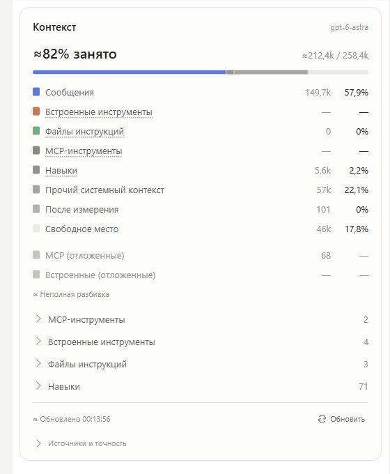

# Codex Chat Context

Панель контекста текущего чата для настольного Codex. Показывает заполненность контекстного окна, примерную разбивку по категориям и списки навыков, инструментов и файлов инструкций. Оформление вдохновлено панелью Context в Claude и адаптировано к компактному интерфейсу Codex.

Текущая версия — **0.3.2**. Проект экспериментальный: он использует локальный журнал Codex и возможности хоста MCP Apps, которые могут меняться между версиями приложения.



*Скриншот компактного интерфейса версии 0.3.1 на данных реального чата. Числа и состав списков зависят от чата; в 0.3.2 исправлен источник списка файлов инструкций.*

## Возможности

- Занятые токены, лимит окна, процент заполненности и свободное место.
- Оценочная разбивка: сообщения, встроенные инструменты, файлы инструкций, MCP-инструменты, навыки, прочий системный контекст и изменения после последнего измерения.
- Раскрываемые списки навыков, инструкций и инструментов; отложенный каталог инструментов отображается отдельно.
- Открытие навыка или файла инструкций отдельной вкладкой Codex. Для инструмента открывается текстовая карточка с доступным описанием.
- Привязка к чату по метаданным Codex и отдельный кеш для каждого чата.
- Автоматическое обновление каждые пять секунд, пока панель видна, и кнопка ручного обновления.
- Светлая и тёмная темы, компактное оформление для узкой панели.

## Установка

Инструкция рассчитана на **Windows и PowerShell**. Разработка и проверка выполнялись в Codex Desktop на Windows с Node.js 24. Работа на других ОС отдельно не проверялась.

Понадобятся **Node.js 20+** в PATH и **Codex Desktop с поддержкой плагинов и MCP Apps**. Git нужен только для клонирования и обновления; можно также скачать ZIP репозитория и распаковать его. Зависимости npm устанавливать не нужно: сервер использует встроенные модули Node.js.

### 1. Клонируйте проект

```powershell
git clone https://github.com/snn02/codex-chat-context.git
cd codex-chat-context
```

### 2. Запустите установщик

Из папки проекта выполните одну команду:

```powershell
powershell -NoProfile -ExecutionPolicy Bypass -File .\install.ps1
```

[install.ps1](install.ps1) сам находит Node.js, проверяет его версию и синтаксис сервера, выбирает Codex CLI с поддержкой установки плагинов, прописывает абсолютные пути в `.mcp.json`, регистрирует локальный каталог и устанавливает плагин. CLI ищется сначала в PATH, затем среди экземпляров, поставляемых с Codex Desktop в `%LOCALAPPDATA%/OpenAI/Codex/bin`.

Права администратора не нужны. Параметр `-ExecutionPolicy Bypass` действует только для этого запуска PowerShell; постоянная политика системы не изменяется. Скрипт работает в Windows PowerShell 5.1 и PowerShell 7, в том числе с пробелами и кириллицей в путях, и определяет папку проекта относительно самого себя.

Скрипт не скачивает зависимости: если Node.js или подходящий Codex CLI отсутствует, он завершится с объяснением. При ошибке установки исходный `.mcp.json` восстанавливается. Уже зарегистрированный каталог может остаться в настройках Codex; после устранения причины можно запустить скрипт повторно. Остальные MCP-серверы и дополнительные поля конфигурации сохраняются.

При нестандартном расположении программ можно явно передать пути:

```powershell
powershell -NoProfile -ExecutionPolicy Bypass -File .\install.ps1 -NodePath 'C:\Program Files\nodejs\node.exe' -CodexPath 'C:\Tools\Codex\codex.exe'
```

Имя репозитория — `codex-chat-context`, но плагин пока сохраняет исходный идентификатор **`context-panel-probe@context-panel-probe-local`** и название **Context Panel Probe** в интерфейсе Codex.

### 3. Откройте панель

Полностью перезапустите Codex. В нужном чате выберите плагин **Context Panel Probe** через меню упоминаний `@` и попросите: «Открой панель контекста». Команда плагина — `open_panel`.

Открывайте панель отдельно в каждом нужном чате. При переключении чатов приложение скрывает и восстанавливает соответствующую вкладку. При первом открытии большого журнала загрузка может занять несколько циклов обновления.

### Обновление и перенос проекта

После `git pull` повторно запустите `install.ps1` и полностью перезапустите Codex. Установщик намеренно меняет локальный `marketplace/plugins/context-panel-probe/.mcp.json`, поэтому Git покажет этот файл изменённым; машинные пути не нужно коммитить. Если Git сообщает о конфликте именно в нём, сохраните собственные дополнительные настройки перед обновлением.

Сервер работает из папки проекта по абсолютному пути. Не удаляйте её после установки. После переноса папки повторно запустите установщик из нового расположения.

## Показатели и алгоритмы

Алгоритмы ниже описывают текущую реализацию 0.3.2 в [context.cjs](marketplace/plugins/context-panel-probe/lib/context.cjs), [collector.cjs](marketplace/plugins/context-panel-probe/lib/collector.cjs) и [panel.js](marketplace/plugins/context-panel-probe/panel.js).

Панель сочетает счётчики Codex с собственной оценкой текста. Знак `≈` обозначает приближение, `—` — отсутствие данных, `0` — известный нулевой результат для доступного источника. `k` — тысячи, `M` — миллионы токенов; числа сокращаются с округлением. Это не счётчик оплаты и не точная копия внутреннего контекста модели.

### Общая заполненность

Обозначения: `B` — последнее измерение Codex, `D` — оценка новых записей после него, `W` — лимит окна из журнала, `U = B + D` — текущая оценка занятого места.

| Показатель | Что означает и как получается |
| --- | --- |
| Занято, токены | `U = B + D`. `B` берётся из события `event_msg` с типом `token_count`: `info.last_token_usage.total_tokens`, либо сумма `input_tokens + output_tokens`, если общего числа нет. Обработчик также поддерживает поле `usage`; резервный источник — `token_usage_record`, пока не встретился `token_count`. Накопленный `total_token_usage` не используется. |
| Лимит справа от `/` | Последнее положительное `model_context_window` из принятого измерения. Лимит не угадывается по названию модели. Без него проценты и свободное место недоступны. |
| Процент занятости | `100 × U / W`. В заголовке округляется до целого, в строках — максимум до одного знака после запятой. |
| Свободное место | `max(0, W − U)`, процент — `100 × свободное / W`. Дополнительного резерва панель не вычитает. |
| Превышение окна | Если `U > W`, показывается предупреждение на `U − W` токенов. Процент может превысить 100%; свободное место равно нулю. Это может быть расхождением оценки с реальным состоянием. |
| Цветная полоса | Сегменты категорий и свободного места пропорциональны их токенам. При превышении окна полоса всё равно занимает ширину карточки, поэтому величину превышения нужно читать в числе и предупреждении. Отложенные каталоги в полосу не входят. |

До первого измерения `B` общий объём не считается, даже если в журнале уже есть текст. Некоторые оценки категорий при этом могут отображаться. После каждого нового измерения `B` заменяется, `D` обнуляется, а текущие оценки категорий фиксируются для разбивки.

### Категории в основной таблице

Процент каждой категории вычисляется относительно **полного окна `W`**, а не относительно занятого места. В таблице ниже `E(text)` — приближённый подсчёт токенов, описанный далее.

| Категория | Источник и алгоритм | Как интерпретировать |
| --- | --- | --- |
| Сообщения | Сумма `E(text)` по доступным `response_item`: сообщениям пользователя и ассистента, аргументам `function_call`/`custom_tool_call` и результатам этих вызовов. На момент измерения фиксируется накопленная оценка. Повторные записи с одним `id` или сочетанием типа и `call_id` пропускаются. | Включает текст результатов инструментов, в том числе прочитанных файлов. Изображения, служебные сообщения и reasoning отдельно не оцениваются. Это оценка доступной истории после последнего сброса, а не точная токенизация запроса. |
| Встроенные инструменты | В текущей версии размер загруженных схем не извлекается: значение остаётся `—`. Из истории собираются имена вызванных инструментов для раскрываемого списка. | Наличие списка не означает известный размер схем. Их невыделенный вклад остаётся в системном остатке. |
| Файлы инструкций | Сумма `E(text)` по явным записям `world_state.state.agents_md`. Поддерживаются строка, поле `content` или `body`. Новая карта заменяет предыдущую. | Упоминания путей в переписке и коде не учитываются. Пустая карта даёт `0`; отсутствие источника — `—`. Пустой список не доказывает, что у модели нет других инструкций. |
| MCP-инструменты | Как и для встроенных инструментов, размер загруженных MCP-схем сейчас неизвестен и отображается как `—`. Имена наблюдавшихся вызовов собираются отдельно. | Это не сумма отложенного каталога и не стоимость выполнения инструментов. |
| Навыки | `E(world_state.state.host_skills.body)` — оценка всего переданного каталога навыков, включая описания и таблицу корней путей. Новый каталог заменяет предыдущий. | Это не сумма содержимого всех `SKILL.md`. Прочитанный через инструмент текст навыка попадает в оценку сообщений. Сумма строк раскрытого списка может отличаться от общей оценки каталога. |
| Прочий системный контекст | `max(0, B − сумма известных категорий после нормировки)`. | Остаток включает неразобранные служебные данные, неизвестные схемы и погрешность оценки. Он не равен точному размеру системного промпта. |
| После измерения | `D`: сумма `E(text)` для новых учитываемых `response_item`, поступивших после последнего счётчика. | При следующем измерении обнуляется. Пока строка растёт, зафиксированная оценка сообщений не растёт вместе с ней, чтобы не прибавлять этот текст дважды. |

Снимки каталога навыков и инструкций обновляют соответствующие категории сразу, даже между измерениями; они не увеличивают `D`. Если известных категорий больше, чем `B`, панель **нормирует** их: умножает каждую на `B / сумму`, затем округляет вниз. Остаток округления относится к системному контексту. Основные категории в сумме дают `B`, а вместе с «После измерения» — `U`. Значения отдельных записей раскрываемых списков при этом не нормируются.

### Отложенные инструменты и раскрываемые списки

| Показатель | Алгоритм и смысл |
| --- | --- |
| MCP (отложенные) | Из `world_state.state.tools` выбираются имена, начинающиеся с `mcp__`. Для каждой строки считается `E(имя + пробел + описание)`, затем оценки суммируются. Это краткий каталог пространств имён, а не обязательно полные схемы отдельных инструментов. |
| Встроенные (отложенные) | Тот же расчёт для остальных имён каталога `tools`. Пустой список отображается как `—`. Оба отложенных каталога не прибавляются к занятому месту; процент для них не вычисляется. |
| Число справа от группы | Количество сохранённых записей списка. Для инструментов складываются записи наблюдавшихся вызовов и отложенного каталога: это не гарантированно число уникальных доступных инструментов. |
| Число справа от навыка | `E(строка описания навыка в каталоге)`. Путь `r0/...`, `r1/...` раскрывается по таблице корней из того же каталога. Размер файла на диске не измеряется. |
| Число справа от файла инструкций | `E(текст из снимка agents_md)`, а не текущий размер файла на диске. Открывается существующий файл по сохранённому пути, его содержимое могло измениться после снимка. |
| Число справа от инструмента | Для записи каталога — оценка имени и описания; для замеченного вызова — `—`, поскольку схема неизвестна. |

Каждая внутренняя группа хранит не более 300 записей. В группах инструментов объединяются два списка, поэтому видимое число может быть больше 300. Полные суммы навыков и инструкций считаются по исходному снимку, даже если список ограничен; сумма отложенного каталога считается по сохранённым записям. Это ещё одна причина, по которой число строк и общий объём не всегда совпадают.

### Как оценивается текст

`E(text)` не использует токенизатор модели. Алгоритм проходит строку по Unicode-символам, суммирует веса и округляет результат **вверх отдельно для каждого оцениваемого блока**:

| Символ | Вес |
| --- | --- |
| Кириллица `U+0400…U+04FF` | `0,52` |
| Кодовая точка выше `U+2FFF`, включая многие иероглифы и emoji | `1` |
| Скобки `{ } [ ] ( )` и знаки `; = < >` | `0,5` |
| Остальные символы, включая латиницу, пробелы и переводы строк | `0,25` |

Правила применяются в указанном порядке. Пустая строка даёт `0`. Метод обеспечивает воспроизводимую приблизительную оценку; для кода, разных языков и мультимодальных данных ошибка может быть существенной.

### Служебные показатели и статусы

| Элемент | Источник или условие |
| --- | --- |
| Модель и уровень reasoning при наведении | Последние `model` и `effort` из `turn_context`. |
| «Обновлено» | Время формирования снимка панели. Это не время последнего измерения токенов. |
| «Счётчик» в разделе «Источники и точность» | Метка времени события, из которого взято `B`. |
| Вход / ответ / кеш входа | `input_tokens`, `output_tokens`, `cached_input_tokens` последнего принятого измерения. Кеш входа показывается справочно: он не вычитается из общего объёма и повторно к нему не прибавляется. |
| Чат / папка / источник | ID из доверенных метаданных MCP сверяется с `session_meta.id`; папка берётся из `session_meta.cwd`. Источник — локальный журнал Codex. |
| «Сжатий в доступном журнале» | Число сбросов истории: явное событие `compacted` **или уменьшение общего счётчика** между измерениями. Поэтому это не строго число реальных автосжатий. |
| «Неполная разбивка» | Был сброс истории, некорректная/слишком большая запись либо достигнут предел учёта идентификаторов. Детализация после этого не считается полной. |
| «Разбивка приведена к измерению Codex» | Оценка известных категорий превысила `B` и была нормирована. Если одновременно история неполная, под полосой показывается сообщение о неполной разбивке. |
| «Читаем журнал… N%» | Доля прочитанных байтов в текущем размере файла. Чтение идёт порциями до 2 МиБ; ещё незавершённая строка ждёт продолжения. Это прогресс загрузки, не заполненность контекста. |
| «Журнал пока не найден» / «Ожидаем первое измерение» | Соответственно не найден файл с ID чата либо в прочитанной истории пока нет пригодного счётчика. |

При `compacted` старые оценки сообщений и `D` сбрасываются, измерение становится неизвестным до следующего счётчика; если журнал содержит заменяющую историю, она обрабатывается заново. При падении счётчика история тоже сбрасывается, но сразу принимается новое измерение. Каталоги навыков, инструкций и инструментов обновляются своими снимками.

Коллектор хранит отдельное состояние для чатов, проверяет совпадение ID и перечитывает журнал при обнаружении его замены или усечения. Записи больше 8 МиБ пропускаются с признаком неполноты; учёт идентификаторов ограничен 50 000. Автообновление запускается примерно через пять секунд после завершения предыдущего запроса и приостанавливается, пока панель скрыта.

## Локальные данные

Панель читает журналы из `$CODEX_HOME/sessions`, а если `CODEX_HOME` не задан — из `~/.codex/sessions`. Она сама не обращается во внешнюю сеть и не вызывает модель для подсчёта.

Интерфейс получает агрегаты, имена инструментов и пути, без текстов сообщений и инструкций. Клик по файлу передаёт его путь Codex для открытия. Карточки инструментов создаются во временной папке `codex-context-files-*`; аргументы и результаты вызовов в них не включаются.

## Если что-то не работает

| Симптом | Что проверить |
| --- | --- |
| В CLI нет команды `plugin` | Нужна версия CLI с поддержкой плагинов; проверьте также CLI из комплекта Codex Desktop. |
| Плагин установлен, но сервер не запускается | Повторно запустите `install.ps1`, затем перезапустите Codex. При необходимости передайте `-NodePath` и `-CodexPath`. |
| Сохранился старый интерфейс или старая команда | Перезапустите Codex и заново откройте панель: уже запущенный MCP-процесс не перечитывает код автоматически. |
| Нет измерения или лимита окна | В локальном журнале чата пока может не быть нужного счётчика. |
| Файл не открывается | Файл должен существовать по сохранённому пути, а хост — поддерживать открытие файлов через MCP Apps. |

## Разработка

Исходники плагина находятся в [`marketplace/plugins/context-panel-probe`](marketplace/plugins/context-panel-probe). Подробности реализации и проверок — в [README плагина](marketplace/plugins/context-panel-probe/README.md).

Из корня репозитория:

```powershell
node --test marketplace/plugins/context-panel-probe/tests/*.test.cjs
node --test tests/install.test.cjs
node --check marketplace/plugins/context-panel-probe/server.cjs
node --check marketplace/plugins/context-panel-probe/panel.js
```

Для панели 0.3.2 предусмотрен 31 тест: подсчёт контекста, изоляция чатов, чтение журнала, открытие файлов, обновление панели и MCP-протокол. Установщик проверяется отдельно на доступных Windows PowerShell 5.1 и PowerShell 7: поиск программ, повторный запуск, пути с пробелами/кириллицей, остановка при ошибках и восстановление конфигурации. Тесты установщика используют подставной CLI и не меняют установленные плагины.
